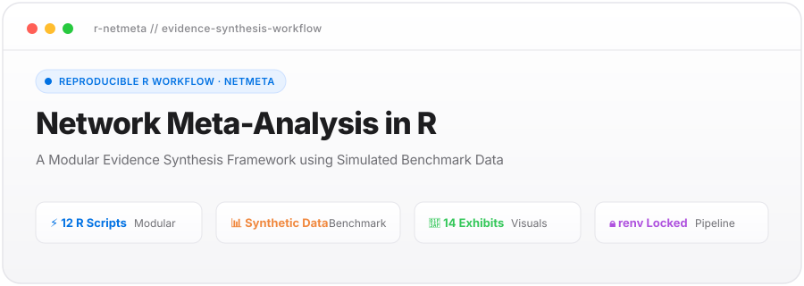
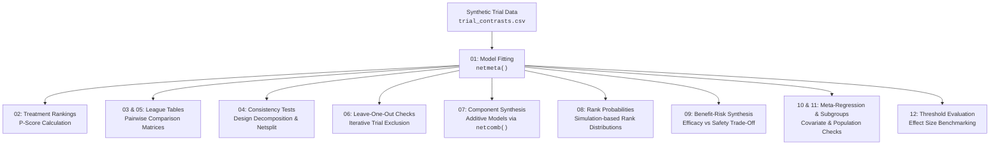

<div align="center">



<br/>

[](https://github.com/mohamed-s-diab/nma-evidence-synthesis/actions/workflows/ci.yml)
[](https://www.r-project.org/)
[](https://rstudio.github.io/renv/)
[](https://cran.r-project.org/package=netmeta)
[](#2-synthetic-benchmark-dataset)
[](#3-analytical-workflow--r-implementation)
[](#6-how-to-run-the-pipeline)
[](https://mohamed-s-diab.github.io/nma-evidence-synthesis/)
[](LICENSE)

</div>

---

> [!IMPORTANT]
> ### 🔍 Transparency & Dataset Disclosure
> This repository is an **educational and programming demonstration** of Network Meta-Analysis in R using the standard `netmeta` package.
> 
> - **The dataset is entirely synthetic / simulated:** The treatments (`Drug A` through `Drug F`) and mock study comparisons are generated benchmark data designed to test data workflows, model fitting, and plotting functions.
> - **Not real clinical data:** It does **not** represent real-world clinical trials or actual patient records, and it must **not** be used for clinical decision-making or medical recommendations.
> - **Focus of this repository:** Clean, reproducible R code, automated workflow orchestration, and clear data visualization.

---

## Table of Contents
- [1. Overview](#1-overview)
- [2. Synthetic Benchmark Dataset](#2-synthetic-benchmark-dataset)
- [3. Analytical Workflow & R Implementation](#3-analytical-workflow--r-implementation)
- [4. Visual Exhibits Gallery](#4-visual-exhibits-gallery)
- [5. Summary Tables](#5-summary-tables)
- [6. Repository Architecture](#6-repository-architecture)
- [7. How to Run the Pipeline](#7-how-to-run-the-pipeline)
- [8. Authorship & Citation](#8-authorship--citation)

---

## 1. Overview

Network Meta-Analysis (NMA) allows researchers to compare multiple interventions simultaneously across a connected evidence network by combining direct trial comparisons with indirect evidence via common reference treatments.

This repository provides a clean, modular, and fully reproducible R workflow for conducting an end-to-end network meta-analysis. It is designed to demonstrate:

1. **Practical R Programming with `netmeta`:** How to load pairwise study data, account for multi-arm trial correlation, fit network meta-analysis models, and inspect results.
2. **Comprehensive Consistency Diagnostics:** How to verify whether direct and indirect evidence agree using node-splitting (`netsplit`) and matrix visualization (`netheat`).
3. **Robustness & Sensitivity Checks:** How to run leave-one-out sensitivity analyses to verify estimate stability.
4. **Publication-Ready Visualizations:** Scripts using `ggplot2` and `patchwork` to generate high-resolution figures (network graphs, forest plots, league tables, rankograms, and benefit-risk plots).
5. **Reproducible Environment:** Pinned dependencies using `renv` and automated tests to ensure any user can replicate the outputs with a single command.

---

## 2. Synthetic Benchmark Dataset

The data in this project represents a synthetic benchmark structure designed to test the R pipeline:

- **Simulated Treatments:**
  - `Drug A`: Reference comparator (standard control backbone).
  - `Drug B`: Active monotherapy.
  - `Drug C`: Combination regimen (backbone + active agent).
  - `Drug D`: Dual-combination regimen.
  - `Drug E`: Targeted monotherapy.
  - `Drug F`: Targeted combination regimen.
- **Simulated Outcomes:**
  - **Primary Efficacy Outcome:** Overall Survival (OS), represented as Hazard Ratios (HR) with 95% confidence intervals.
  - **Secondary Safety Outcome:** Severe Adverse Events, represented as Odds Ratios (OR) with 95% confidence intervals.
- **Data Files:**
  - `data/trial_contrasts.csv`: Study names, treatment comparisons, log hazard ratios, and standard errors.
  - `data/toxicity_events.csv`: Event counts and total sample sizes across treatment arms for safety synthesis.

---

## 3. Analytical Workflow & R Implementation

The analytical pipeline is broken down into 12 standalone, sequential R scripts in `scripts/analyses/`. The focus is strictly on practical code implementation and data flow:



### Script-by-Script Workflow

1. **`01_fit_nma_model.R` (Model Fitting):**
   Reads `data/trial_contrasts.csv`, formats effect sizes and standard errors, adjusts for shared control arms in multi-arm trials, and fits both common-effects and random-effects network models using `netmeta::netmeta()`.
2. **`02_treatment_rankings.R` (P-Scores):**
   Computes frequentist P-scores for each treatment regimen. P-scores measure the relative performance of each treatment across all network comparisons (ranging from 0 to 1).
3. **`03_league_table.R` & `05_league_table_html.R` (League Tables):**
   Generates a full comparative matrix displaying relative effect estimates and 95% confidence intervals between all pairs of treatments, exported as CSV and interactive HTML.
4. **`04_inconsistency_tests.R` (Consistency Diagnostics):**
   Evaluates statistical agreement between direct within-trial evidence and indirect comparisons using global variance partitioning and local node-splitting (`netmeta::netsplit()`).
5. **`06_leave_one_out_sensitivity.R` (Leave-One-Out Sensitivity):**
   Iteratively excludes one study at a time and refits the network model to test whether any single study disproportionately alters treatment rankings or effect estimates.
6. **`07_component_nma.R` (Component NMA):**
   For combination therapies, uses `netmeta::netcomb()` to assess the incremental effect of adding specific individual drug components to a backbone therapy.
7. **`08_rank_probabilities.R` (Rank Distributions):**
   Draws samples from the estimated effect distributions to generate rank histograms and cumulative ranking curves (rankograms).
8. **`09_benefit_risk_tradeoff.R` (Benefit-Risk Trade-Off):**
   Synthesizes efficacy (survival hazard ratios) and safety (adverse event odds ratios) concurrently to map treatments on a 2D trade-off grid.
9. **`10_network_metaregression.R` & `11_subgroup_analysis.R` (Covariates & Subgroups):**
   Screens for potential effect-modifying study characteristics (such as study size or region) using meta-regression and subgroup analyses.
10. **`12_mcid_analysis.R` (Threshold Evaluation):**
    Evaluates the probability that each treatment achieves a predefined meaningful improvement threshold (e.g., HR ≤ 0.80) relative to the reference comparator.

---

## 4. Visual Exhibits Gallery

All figure generation scripts are located in `scripts/designs/` and save high-resolution PNG outputs in `outputs/figures/`:

| Figure | Script | Description |
| :--- | :--- | :--- |
| **Figure 01** | `fig01_network_geometry.R` | Network graph displaying treatment nodes, direct study connections, and multi-arm trial loops. |
| **Figure 02** | `fig02_forest_plot.R` | Forest plot of all treatments versus reference comparator `Drug A`. |
| **Figure 03** | `fig03_pscore_ranking.R` | Bar chart of frequentist P-score rankings under random and common effects. |
| **Figure 04** | `fig04_netsplit_inconsistency.R` | Node-splitting forest plot showing direct vs indirect estimates across closed loops. |
| **Figure 05** | `fig05_netheat_plot.R` | Net Heat matrix plot assessing evidence leverage and inconsistency contributions. |
| **Figure 06** | `fig06_funnel_plot.R` | Comparison-adjusted funnel plot assessing evidence symmetry. |
| **Figure 07** | `fig07_league_table_matrix.R` | Visual league table grid presenting all head-to-head and indirect comparisons. |
| **Figure 08** | `fig08_leave_one_out_forest.R` | Sensitivity forest plot showing effect stability across leave-one-out iterations. |
| **Figure 09** | `fig09_component_effects.R` | Component forest plot showing incremental effects of constituent agents. |
| **Figure 10** | `fig10_rankograms.R` | Rank probability histograms and cumulative SUCRA curves for each treatment. |
| **Figure 11** | `fig11_benefit_risk_tradeoff.R` | 2D scatter plot mapping efficacy (survival) against toxicity (severe adverse events). |
| **Figure 12** | `fig12_metaregression_bubble.R` | Meta-regression bubble plot evaluating potential effect modifiers. |
| **Figure 13** | `fig13_subgroup_forest.R` | Subgroup forest plot comparing estimates across study categories. |
| **Figure 14** | `fig14_mcid_probabilities.R` | Bar chart of probabilities achieving the predefined clinical benchmark (HR ≤ 0.80). |

---

## 5. Summary Tables

### Table 1 · Treatment Rankings & P-Scores (Synthetic Data Benchmark)

| Treatment Regimen | Rank | P-Score (Random) | P-Score (Common) | HR vs Drug A [95% CI] | p-value vs Drug A |
| :--- | :---: | :---: | :---: | :---: | :---: |
| **`Drug C`** | **1** | **0.9428** | **0.9428** | **0.69 [0.64; 0.74]** | **< 0.0001** |
| **`Drug F`** | **2** | 0.7543 | 0.7543 | 0.72 [0.63; 0.83] | < 0.0001 |
| **`Drug D`** | **3** | 0.5854 | 0.5854 | 0.76 [0.69; 0.84] | < 0.0001 |
| **`Drug B`** | **4** | 0.5133 | 0.5133 | 0.78 [0.71; 0.84] | < 0.0001 |
| **`Drug E`** | **5** | 0.2009 | 0.2009 | 0.90 [0.82; 0.99] | 0.0327 |
| **`Drug A`** | **6** | 0.0033 | 0.0033 | 1.00 [Reference] | Reference |

*Generated by: [`scripts/analyses/02_treatment_rankings.R`](scripts/analyses/02_treatment_rankings.R)*

---

### Table 2 · Global Consistency Check (Cochran's Q Decomposition)

| Source | Q Statistic | df | p-value | Interpretation |
| :--- | :---: | :---: | :---: | :--- |
| **Total Variation (Q)** | **21.44** | **23** | **0.5544** | No significant excess variation |
| **Within-Designs Heterogeneity** | **17.25** | **15** | **0.3043** | Consistent within trial designs |
| **Between-Designs Inconsistency** | **4.19** | **8** | **0.8396** | **Direct and indirect evidence agree** |

*Generated by: [`scripts/analyses/04_inconsistency_tests.R`](scripts/analyses/04_inconsistency_tests.R)*

---

## 6. Repository Architecture

```
.
├── DESCRIPTION                            # R package metadata & dependency list
├── renv.lock                              # Pinned package environment lockfile
├── data/
│   ├── trial_contrasts.csv                # Synthetic trial contrast dataset (survival)
│   └── toxicity_events.csv                # Synthetic adverse event dataset (safety)
├── scripts/
│   ├── analyses/                          # 12 sequential analytical R scripts
│   │   ├── 01_fit_nma_model.R
│   │   ├── 02_treatment_rankings.R
│   │   ├── 03_league_table.R
│   │   ├── 04_inconsistency_tests.R
│   │   ├── 05_league_table_html.R
│   │   ├── 06_leave_one_out_sensitivity.R
│   │   ├── 07_component_nma.R
│   │   ├── 08_rank_probabilities.R
│   │   ├── 09_benefit_risk_tradeoff.R
│   │   ├── 10_network_metaregression.R
│   │   ├── 11_subgroup_analysis.R
│   │   └── 12_mcid_analysis.R
│   ├── designs/                           # 14 publication figure plotting scripts
│   │   ├── fig01_network_geometry.R
│   │   ├── ...
│   │   └── fig14_mcid_probabilities.R
│   └── run_all_pipeline.R                 # Master script to execute full pipeline
├── tests/
│   └── test_pipeline_integrity.R          # Test suite verifying scripts & data integrity
├── outputs/
│   ├── figures/                           # Rendered PNG figures
│   ├── tables/                            # Generated CSV & HTML tables
│   └── models/                            # Saved R model objects (.rds)
├── report/
│   ├── nma_comprehensive_report.Rmd       # R Markdown comprehensive report
│   └── nma_comprehensive_report.html      # Compiled HTML report
├── CITATION.cff                           # Citation metadata
└── LICENSE                                # MIT Open Source License
```

---

## 7. How to Run the Pipeline

### Step 1: Restore Package Environment
This project uses `renv` to lock package versions. In your R console:
```r
install.packages("renv")
renv::restore()
```

### Step 2: Run Verification Tests
Verify dataset integrity, script syntax, and output folder structure:
```bash
Rscript tests/test_pipeline_integrity.R
```

### Step 3: Run the Complete Pipeline
Execute all 12 analytical scripts and generate all 14 figures in one step:
```bash
Rscript scripts/run_all_pipeline.R
```

### Step 4: Build the HTML Report
Compile the standalone summary report:
```r
rmarkdown::render("report/nma_comprehensive_report.Rmd")
```

---

## 8. Authorship & Citation

Developed by:
- **Mohamed Said Mohamed Diab** (R programming, pipeline design, visualization)
- Collaborators & contributors: Badr Essam Ali, Ali Hassan Hafez, Omar Gomaa Mousa, Mahmoud Hussein Fathy
- Faculty of Medicine, Modern University for Technology and Information (MTI), Cairo, Egypt.

<br/>

<p align="left">
  <a href="mailto:Mohamed.98478@Medicine.mti.edu.eg"></a> <a href="https://orcid.org/0009-0003-3143-387X" target="_blank" rel="noopener"></a> <a href="https://scholar.google.com/citations?user=_tJ3MkYAAAAJ" target="_blank" rel="noopener"></a> <a href="https://www.researchgate.net/profile/Mohamed-Said-Mohamed-Diab" target="_blank" rel="noopener"></a>
</p>


### Citation Format

```bibtex
@software{diab2026_reproducible_nma,
  author       = {Diab, Mohamed Said Mohamed and Ali, Badr Essam and Hafez, Ali Hassan and Mousa, Omar Gomaa and Fathy, Mahmoud Hussein},
  title        = {Reproducible Frequentist Network Meta-Analysis Framework in R (Simulated Benchmark Pipeline)},
  year         = {2026},
  version      = {1.0.0},
  publisher    = {GitHub},
  url          = {https://github.com/mohamed-s-diab/nma-evidence-synthesis}
}
```

### License
This project is open-source and released under the [MIT License](LICENSE).
